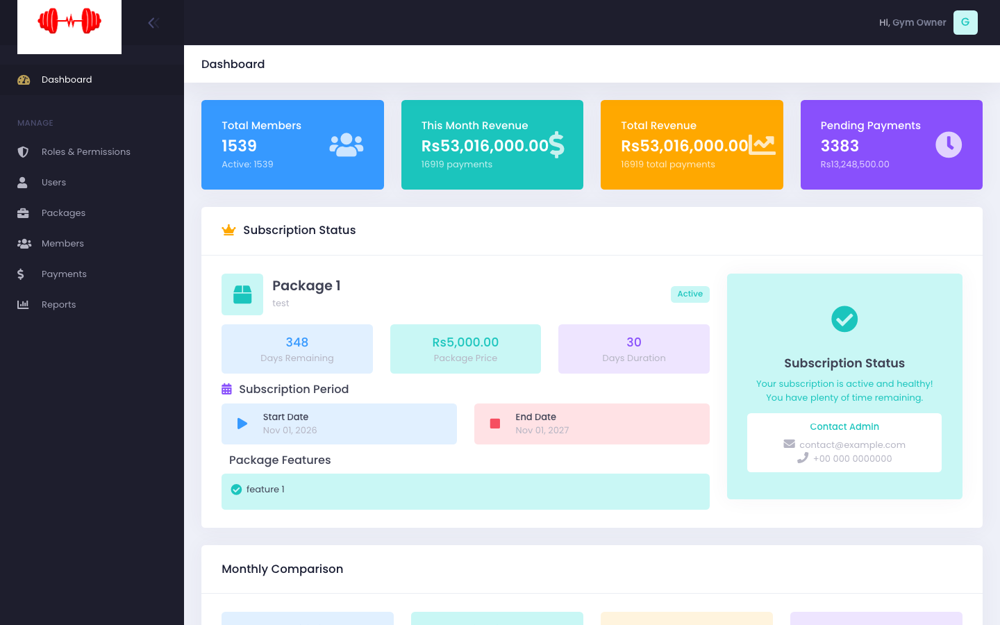
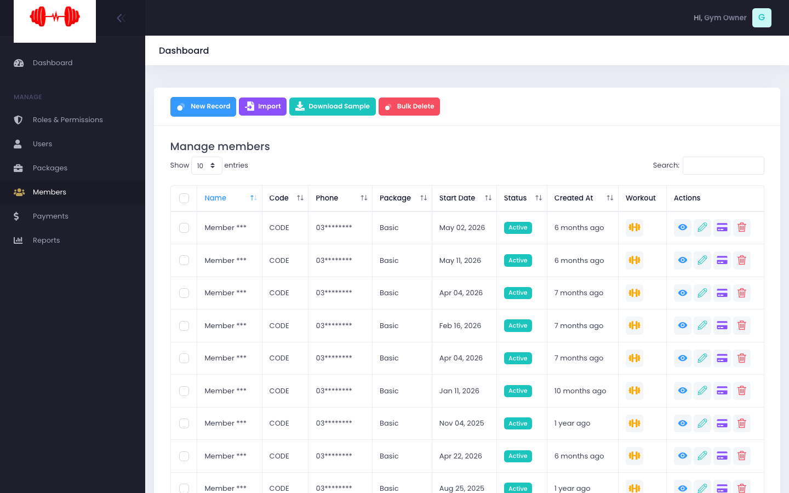
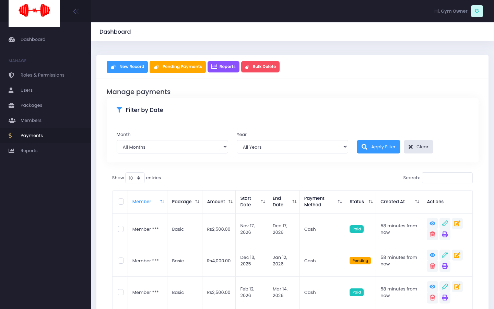
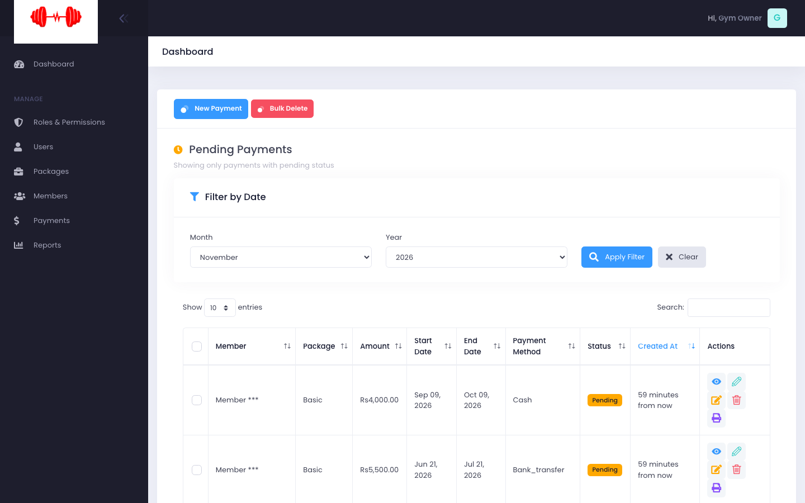
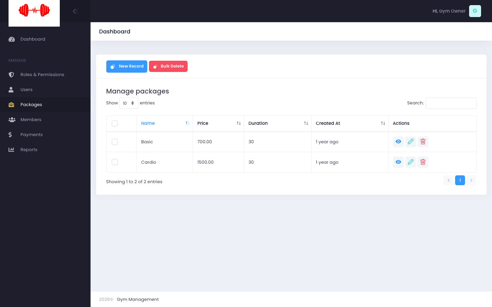
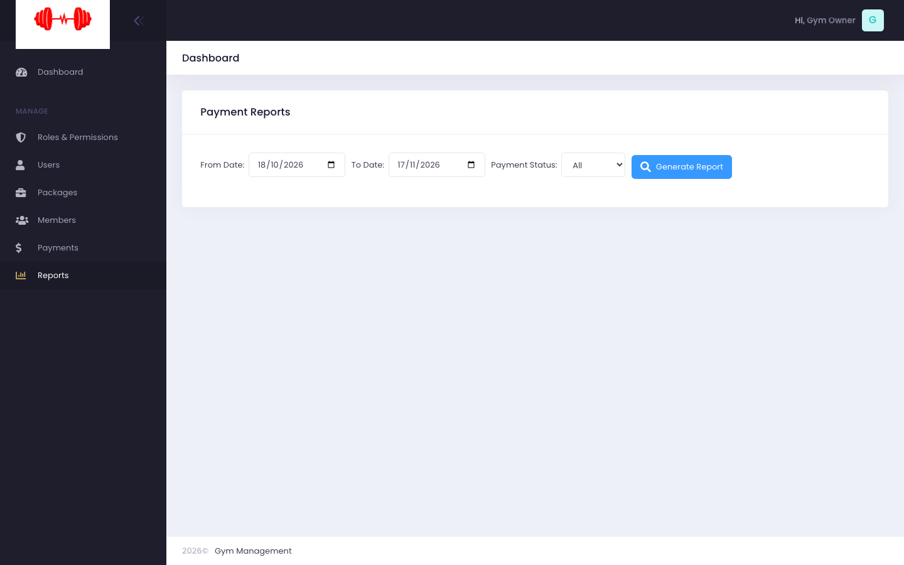
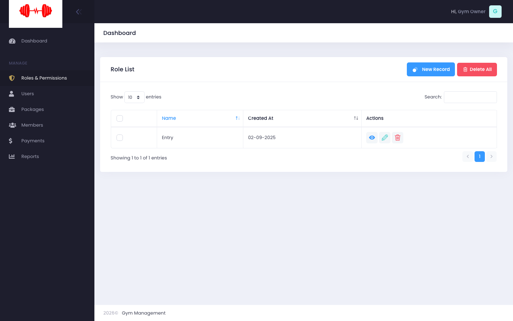

# Gym Management System

Multi-tenant **gym / fitness membership platform** on Laravel — member lifecycle, packages, payments, staff roles, reports, and subscription billing for gym businesses. Built to run day-to-day ops for gyms managing **more than 1,600 users** and **16,919 payments** in the system.

---

## Why this is useful

Gyms outgrow spreadsheets fast: renewals slip, front-desk staff need limited access, and owners need revenue visibility without exposing every member record across branches.

| Pain | What the platform does |
|------|------------------------|
| Thousands of members, messy renewals | **Member registry** with codes, packages, status, start dates, bulk import/export |
| Front desk vs owner access | **Roles & permissions** (Spatie) for Admin / Staff / scoped users |
| Package pricing changes | Configurable **membership packages** (price, duration, features) |
| Cash / card / pending dues | **Payments** + **pending payments** workflows and filters |
| Owner wants a pulse check | **Dashboard** — total/active members, revenue, pending dues, subscription health |
| SaaS-style gym software sales | **Subscription packages** + history so gym businesses stay on an active plan |
| Ops reporting | **Reports** for membership and payment activity |

---

## Screenshots

| | |
|--|--|
| Dashboard (1,500+ members) |  |
| Members |  |
| Payments (16,919 records) |  |
| Pending payments |  |
| Packages |  |
| Reports |  |
| Roles & permissions |  |

---

## Scale

Production-style dataset exercised in this build:

- **More than 1,600 users** across members + staff accounts
- **16,919 payments** tracked (paid + pending)
- Single gym owner view with **~1,500+ active members** on the dashboard
- Bulk member import, search/filter DataTables, and package assignment at scale

---

## Core features

### Members
- CRUD + member codes, phone, package, status
- Bulk **import** / sample CSV / bulk delete
- Per-member workout hooks and payment shortcuts

### Packages & payments
- Membership packages (price, duration)
- Payment records, pending dues, date filters
- PDF-friendly receipts (DomPDF)

### Access control
- Spatie **roles & permissions**
- Admin middleware gate for `/admin/*`
- Gym-owner subscription expiry gate on login

### Multi-business SaaS layer
- Gym businesses as tenant users
- Subscription package catalog + history
- Settings (branding, contact, branch hours)

### API surface
- Member / payment / auth / report JSON endpoints for mobile or kiosk clients

---

## Stack

| Layer | Choice |
|-------|--------|
| Backend | Laravel 8, PHP 8.1+ |
| Auth / ACL | Laravel UI + Spatie Permission |
| UI | Blade admin theme (Metronic-style assets) |
| DB | MySQL |
| PDFs | DomPDF |
| Images | Intervention Image |

---

## Quick start

```bash
composer install
cp .env.example .env
php artisan key:generate
# configure DB_* in .env
php artisan migrate --seed
php artisan serve
```

---

## Project layout

```
app/Http/Controllers/Admin/   # Dashboard, members, payments, packages, roles, reports
app/Http/Controllers/Api/     # Member/payment/auth JSON APIs
app/Models/                   # Member, Package, Payment, User, …
database/migrations|seeders/  # Schema + demo data
resources/views/admin/        # Blade admin screens
routes/web.php|api.php        # Web admin + API
```

---

## License

Source shared for portfolio / evaluation. Not a public SaaS offering.
